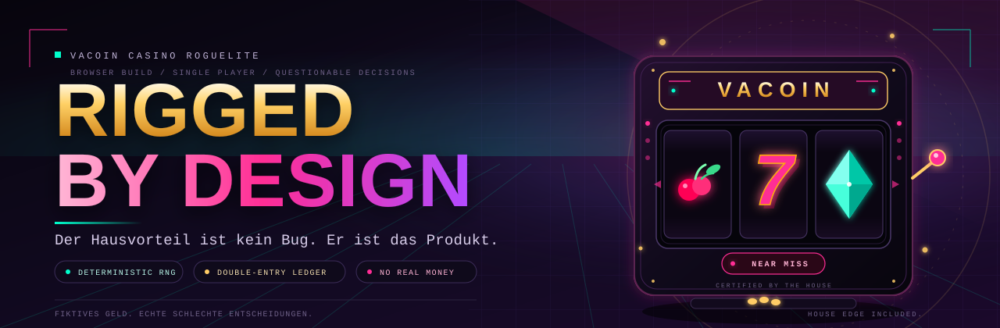

<p align="center">
  
</p>

<h1 align="center">Rigged by Design</h1>

<p align="center">
  <strong>VaCoin Casino Roguelite</strong><br>
  Vite · React 19 · TypeScript · PixiJS 8 · Vitest
</p>

> „Der Hausvorteil ist kein Bug. Er ist das Produkt.“

**Kein Echtgeld. Keine echten Casinos. Nur fiktive VaCoins, echte schlechte Entscheidungen und ein RNG, das genau das tut, was man ihm sagt.**

---

## Was ist das?

Ein Browser-Casino-Roguelite über die Karriere eines Menschen, der mit einem Pappkarton und drei Bechern anfängt und damit endet, anderen Menschen einen Pappkarton mit drei Bechern zu verkaufen. Dazwischen: Slots, Würfel, Near Misses, ein Ledger, das nicht lügt, und ein RNG, das sich innerhalb definierter Grenzen bestechen lässt.

Du startest mit **0,0000 VC**. Kein Kredit, keine Investoren, keine Gnade. Der erste Job ist Pfand sammeln, nicht „ich fühle einen Jackpot“. Das CPU-Slot-Fenster öffnet erst, wenn auf deinem Floor ein Spielautomat steht; die Tische öffnen mit Hütchenspiel-Karton oder Würfeltisch. Vorher gibt es nichts zu spielen.

Der zweite Teil ist wichtiger: Du baust dein eigenes Casino. Acht mal acht Felder, ein paar Automaten, ein roter Teppich, ein Neon-Schild. Besucher kommen, spielen, verlieren, bleiben. **Du** wirst die Bank. Das ist pädagogisch wertvoll, solange man nicht darüber nachdenkt, was es über einen sagt.

## Die Schleife

1. **Arbeiten gehen.** Pfand und Flyer sammeln oder eine Türsteher-Schicht schieben. Klingt erniedrigend, ist aber der einzige Weg aus dem Startloch. Bei 0 VC ist der erste Klick kein Spin, sondern ein Job.
2. **Erst bauen, dann zocken.** Ein eigener Spielautomat schaltet das CPU-Slot-Fenster frei, ein Hütchenspiel-Karton oder Würfeltisch die Tische. Dann: Rostige Spelunke für den Ziel-RTP von 94 %, Syndikat-Lounge für den Ziel-RTP von 58 % und den Satz „diesmal ist es anders“.
3. **Eigenes Casino bauen.** Hütchenspieler-Karton, rostiger Slot, Würfeltisch, Neon-Kabinett, Teppich, Reklameschild, Fusel-Spender. Alles mit festen Preisen und ohne Finanzierungsrunde.
4. **Besucher empfangen und auszahlen.** Sie haben eine Brieftasche, Geduld und eine Sucht-Leiste. Du hast einen Tresor und Betriebskosten. Gewinne werden als `PENDING_PAYOUT` reserviert; erst wenn du sie manuell auszahlst, darf der Gast weiterzocken. Rate, wer länger durchhält.
5. **Im RNG-Labor nachrechnen.** Soll vs. Ist, Trefferquote, LDW-Quote, Near-Miss-Quote, gemessener RTP, Hausvorteil, Sucht-Score. Damit du weißt, ob dein Automat ein Produkt oder ein Beweisstück ist.
6. **Dich selbst ausrüsten.** Fünf Player-Mods, ein sichtbarer Paper-Doll und ein Suspicion-Wert, der irgendwann den Türsteher ruft.

Der Fortschritt ist ein Kreislauf aus „ich brauche mehr Kapital“ und „ich hatte gerade genug Kapital“. Willkommen im Kapitalismus mit Spielautomaten.

## Was drin ist

| Bereich | Inhalt |
| --- | --- |
| **RNG-Kern** | Seeded Mulberry32, `getState`/`setState`, gewichtete Pools, Bias-Verträge mit harten Grenzen und sauberer Normalisierung. |
| **Slots** | 3×3-Raster, 1–3 Paylines, fünf Symbole, Near-Miss-Inszentierung, LDW-Erkennung und installierbare Betreiber-Mods. |
| **Hütchenspiel** | 3–5 Becher, Einzel- oder Doppelkugel, Magnet-Bias, Heat-Wert und exakte RTP-Auswertung. |
| **Würfel** | 2–4 W6, Over/Under, Lucky 7, Pasch-Jagd, gewichtete Seiten und optionaler Teufelswürfel. |
| **Wirtschaft** | VaCoins als Micro-Units, sieben Ledger-Konten inklusive `VISITOR_WALLET` und `PENDING_PAYOUT`, keine negativen Salden, doppelte Buchführung und Integritätsprüfung. |
| **Eigenes Casino** | 8×8-Grid, Slots, Hütchenspiel, Würfeltisch, Deko, Besucher-Simulation, Geduld, Sucht und Bankrott. Jeder Gast-Spin erscheint als symbolisches Popup mit Cash-Tick; die Gesamtbilanz steht als rot/grünes `Σ` am Gast. |
| **Charakter** | Prozeduraler PixiJS-Paper-Doll, fünf Player-Mods, Ausrüstung, Suspicion und Rauswurf mit Ledger-Buchung. |
| **Bühne** | Der 8×8-Floor ist die Hauptfläche; Slot, Hütchenspiel und Craps öffnen als eigene Fenster. Komplett prozedurale PixiJS-Grafik, keine externen Bild-URLs. |
| **Beweislabor** | 1.000 oder 10.000 Spins, Soll-/Ist-Balken pro Symbol, RTP-/Sucht-Kennzahlen und Seed-Reproduzierbarkeits-Check. |
| **Persistenz** | Automatischer Spielstand in `localStorage`, inklusive Ledger-Replay und Wiederherstellung des RNG-Zustands. |

## Schnellstart

Voraussetzung: **Node 22** (die CI nutzt Node 22) und npm.

```bash
npm ci
npm run dev
```

Der Dev-Server läuft standardmäßig auf [http://localhost:3000](http://localhost:3000).

Für alle Gates in einem Rutsch:

```bash
npm run verify:all
```

Das sind LOC-Guillotine, Typecheck, Tests und Production-Build. Ja, alle vier. Nein, du kannst die LOC-Prüfung nicht mit einem Kommentar „vorübergehend“ deaktivieren.

## Steuerung

| Tab | Was du dort machst |
| --- | --- |
| **1. Arbeiten & CPU-Casinos** | Jobs mit Cooldown, Casino wählen, Einsatz setzen und das Slot-Fenster öffnen. Ohne gebautes Spiel bleibt der Spin gesperrt. |
| **2. Eigenes Casino & Baumarkt** | Objekte kaufen und auf dem 8×8-Grid platzieren, Gäste mit Wallet, Sucht und Zustand beobachten und offene Gewinne manuell auszahlen. |
| **3. RNG-Labor & Werkstatt** | Eigene Slots tunen, Betreiber-Mods kaufen und die Mathematik mit 1.000 oder 10.000 Spins live prüfen. |
| **4. Charakter & Mods** | Aussehen ändern, Player-Mods kaufen und ausrüsten, Suspicion-Risiko und Luck-Bonus vergleichen. |

Der **Casino-Floor** ist die Hauptbühne und bleibt sichtbar. **CPU-Slot**, **Hütchenspiel** und **Street Craps** öffnen sich als eigene Fenster und schließen sich wieder; der Floor läuft dahinter weiter. Das Slot-Fenster ist gesperrt, bis ein eigener Spielautomat steht. Die Tisch-Fenster brauchen einen Hütchenspiel-Karton oder Würfeltisch.

Der Spielstand wird nach Aktionen und mit jedem Simulations-Tick automatisch gespeichert. Er liegt lokal im Browser. Kein Account, kein Cloud-Sync, keine Ausrede: Wer die Browserdaten löscht, startet wieder mit 0,0000 VC und muss erneut Pfand sammeln.

## Architektur

```text
src/
  core/       Headless TypeScript: RNG, Slots, Spiele, Wirtschaft, Simulation, Charakter
  stage/      PixiJS v8: prozedurale Renderer, Animationen, Partikel
  store/      Reaktiver Game-State, Command-API und Save/Load
  styles/     Modulare CSS-Schichten in unveränderter Kaskadenreihenfolge
  ui/         React: HUD, Tabs, Werkstatt, Charakter-Panel
scripts/      LOC-Guard, Version-Bump, GitHub-Init
docs/         Banner und Dokumentation
.github/      CI- und Release-Workflows
```

Die Regeln sind nicht dekorativ:

1. **200 LOC pro `.ts`/`.tsx`-Datei.** Komplexe Renderer dürfen 350 LOC haben, aber nur mit einem begründeten `// @loc-exception:`-Header in Zeile 1. Der Guard heißt `scripts/check-loc.mjs` und beendet sich mit Exit-Code 1, wenn jemand kreativ wird.
2. **`src/core/` ist headless.** Kein React, kein PixiJS, kein DOM. Die Wirtschaft und die Spiele müssen auch ohne Browser beweisbar sein.
3. **Geld ist ganzzahlig.** `1,0000 VC = 10.000` Micro-Units. Keine Floats, keine `0.1 + 0.2`-Überraschungen, keine Ausreden über Gleitkomma.
4. **Jede Buchung läuft über das Ledger.** Besucher-Wallets liegen als gepooltes `VISITOR_WALLET` im Ledger, Gewinne warten als `PENDING_PAYOUT` auf deine Auszahlung. Beim Spawn, Einsatz, Gewinn, Auszahlen und Verlassen des Casinos wird gebucht. Konten dürfen nicht ohne Deckung ins Minus. Die Summe aller Bewegungen muss exakt null ergeben. Geld wird nicht gedruckt, außer durch `EXTERNAL_WORK` – und das ist ein Job, kein Gelddruck.

## Mathematik, kurz und ehrlich

- **RTP** ist das Verhältnis von Auszahlung zu Einsatz über eine große Stichprobe. Kein Versprechen, dass du „dein Geld zurückbekommst“. Ein RTP von 94 % bedeutet im Erwartungswert 6 % Hausvorteil – deine persönliche Stichprobe darf davon abweichen. Meistens nach unten.
- **LDW** heißt „Loss Disguised as Win“: Du bekommst etwas zurück, aber weniger als deinen Einsatz. Es fühlt sich wie ein Gewinn an, ist buchhalterisch aber ein Verlust. Das ist der Punkt.
- **Near Miss** ist eine Inszenierung nach einer Niete, kein heimlicher Gewinn. Zwei Jackpot-Symbole und dann doch nichts sind kein Zufall, sondern Produktdesign.
- **Der Sucht-Score** ist ein Modell aus Trefferquote, LDW, Near Miss, Paylines und RTP. Er ist keine klinische Diagnose und kein Bonus, den man freischalten sollte.
- **Das RNG ist deterministisch.** Gleicher Seed, gleiche Config, gleiche Sequenz. Dein Pech ist reproduzierbar. Das ist immerhin wissenschaftlich.

Die genauen Ziel- und Messwerte stehen im Katalog und im RNG-Labor. Was dort als „fair“ bezeichnet wird, ist eine Designentscheidung, kein Naturgesetz.

## Gates und Releases

`ci-verify.yml` läuft bei Pull Requests gegen `main` und bei Pushes auf Feature-Branches:

1. **LOC-Guillotine** – `npm run check:loc`
2. **Type-Safety** – `npm run typecheck`
3. **RNG-, Ledger- & Regel-Beweise** – `npm run test:ci`
4. **Production Build** – `npm run build`

`auto-version-release.yml` läuft nach dem Merge auf `main`, erhöht die Version anhand der Commit-Nachricht (`feat:` → Minor, `BREAKING CHANGE`/`[major]` → Major, sonst Patch), committet `chore(release): vX.Y.Z [skip ci]`, taggt und erstellt ein GitHub-Release. Der Workflow ignoriert seine eigenen Release-Commits, damit er nicht in einer Endlosschleife Releases über Releases legt.

Trockenlauf der Versionserkennung:

```bash
node scripts/ci-bump-version.mjs --dry-run
```

Conventional Commits sind keine Bürokratie, sondern die einzige Chance, dass der Bump nicht rät. Und er rät trotzdem. Aber dokumentiert.

## Was (noch) nicht drin ist

- **Blackjack und Poker** sind als Ziel für Player-Mods vorgesehen, aber es gibt noch keine vollständigen Tische. Der RNG-Kern ist dafür wiederverwendbar, die Tische fehlen.
- **Multiplayer, Accounts und Cloud-Saves** gibt es nicht. Der Spielstand lebt im Browser, nicht in einem Rechenzentrum mit besserem Marketing.
- **Echtgeld, Käufe oder Auszahlungen** gibt es nicht. VaCoins sind fiktiv und haben keinen Gegenwert. Das ist Absicht.
- **Ein Reset-/Export-Button** fehlt aktuell. Der offizielle Workaround ist „Browserdaten löschen“, was technisch funktioniert und menschlich unbefriedigend ist.

## Ernst gemeint

Dieses Spiel simuliert bewusst suchtfördernde Mechaniken: Near Misses, LDW, steigende Einsätze, Besucher mit Geduld und Sucht. Das ist Satire über Glücksspielprodukte, kein Glücksspielprodukt. Es gibt kein Echtgeld, keine Einzahlung und keinen Gewinn, der irgendwo ankommt.

Wenn Glücksspiel für dich aufgehört hat, ein Spiel zu sein, ist die [BZgA](https://www.bzga.de/) ein besserer Ansprechpartner als dieses Repository. Diese README ist keine Therapie. Sie ist nur ehrlicher als die meisten Spielautomaten.
